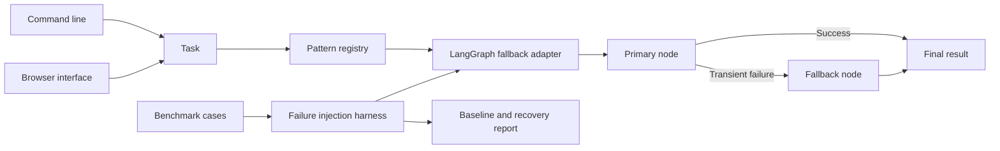

# Open Agent Patterns

Define a small agent pattern interface, register extensions, and benchmark a safe fallback pattern.

## Quick start

Requires Python 3.11 or newer. From this repository:

```powershell
python -m venv .venv
.\.venv\Scripts\Activate.ps1
python -m pip install -e '.[dev]'
pytest -q
```

On macOS or Linux:

```bash
python3 -m venv .venv
source .venv/bin/activate
python -m pip install -e '.[dev]'
pytest -q
```

This project uses deterministic tests and needs no model key for verification.

The installed `agent-fallback` product calls a primary JSON HTTP endpoint and switches to a fallback endpoint on timeout, connection failure, or transient server error. Each endpoint receives `{"task":"..."}` and returns `{"output":"..."}`. Run `agent-fallback run "summarize this" --primary-url https://primary.example/transform --fallback-url https://backup.example/transform` after replacing the URLs. Use `agent-fallback serve --port 8080` for the local browser at `http://127.0.0.1:8080`; provide endpoints in the form. Run `python benchmarks/run.py` for the deterministic LangGraph recovery benchmark. Non-transient client and response-schema errors remain visible rather than silently falling back.

```python
from open_agent_patterns.engine import BenchmarkCase, PatternRegistry, SafeFallbackPattern

registry = PatternRegistry()
registry.register(SafeFallbackPattern(lambda task: task.upper(), lambda task: "unavailable"))
print(registry.benchmark("safe-fallback", [BenchmarkCase("hello", "HELLO")]))
```

## Architecture



| Component | Responsibility |
|---|---|
| Pattern contract | Defines a registry and stable `run` interface. |
| LangGraph adapter | Builds a bounded recovery graph using StateGraph. |
| Benchmark harness | Checks deterministic accuracy and injected failures. |

Pattern protocol -> registration with unique name -> context-isolated invocation -> benchmark cases -> accuracy and latency report.

See [ARCHITECTURE.md](ARCHITECTURE.md) for components, state, failure behavior, and operations.

## Deployment and safety

See [DEPLOYMENT.md](DEPLOYMENT.md) for the non-root container, token-protected browser, data mounts, and release checks.

This repository is a standalone reference extension and contribution package. It does not claim an upstream LangGraph, CrewAI, or AutoGen merge. Choose an upstream project, adapt its interface and tests, and submit a PR under that project's contribution rules.

The optional LangGraph adapter in `src/open_agent_patterns/langgraph_adapter.py` builds a runnable recovery graph. Install `.[langgraph]` to use it. `python benchmarks/run.py` runs the deterministic benchmark dataset; see [CONTRIBUTING.md](CONTRIBUTING.md) before proposing an upstream PR.

See [TUTORIAL.md](TUTORIAL.md) for a complete LangGraph walkthrough and the limits of the failure-injection benchmark.

Install this as a library in an authenticated application or worker. Register trusted handlers and keep application secrets outside source control.

## Verification

`pytest -q` runs deterministic tests. GitHub Actions runs the same suite on pushes and pull requests.

## License

MIT. See [LICENSE](LICENSE).
