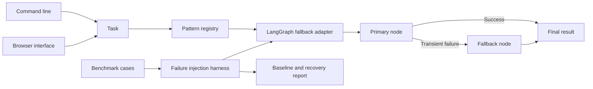

# Open Agent Patterns

## About

This repository is a working pattern for recovering when an agent's primary tool or service is temporarily unavailable. It tries a primary JSON endpoint, switches to a fallback endpoint for transient failures, and keeps non-transient errors visible. It also includes a small registry, a LangGraph adapter, and a benchmark that injects failures so you can measure recovery behavior.

### What you can do

- Run a primary and fallback endpoint from the CLI or local browser.
- Reuse the fallback pattern in a Python application.
- Run a deterministic benchmark with success and failure cases.
- Follow the tutorial to adapt the pattern for an upstream open-source project.

This is a standalone project and contribution-ready reference, not a claim that a PR has been merged into LangGraph, CrewAI, or AutoGen. The local browser accepts endpoint URLs for development; only configure services you trust. There is no public hosted URL yet.

## Quick start

Requires Python 3.11 or newer. From this repository:

```powershell
python -m venv .venv
.\.venv\Scripts\Activate.ps1
python -m pip install -e '.[dev]'
pytest -q
```

On macOS or Linux:

```bash
python3 -m venv .venv
source .venv/bin/activate
python -m pip install -e '.[dev]'
pytest -q
```

This project uses deterministic tests and needs no model key for verification.

The installed `agent-fallback` product calls a primary JSON HTTP endpoint and switches to a fallback endpoint on timeout, connection failure, or transient server error. Each endpoint receives `{"task":"..."}` and returns `{"output":"..."}`. Run `agent-fallback run "summarize this" --primary-url https://primary.example/transform --fallback-url https://backup.example/transform` after replacing the URLs. Use `agent-fallback serve --port 8080` for the local browser at `http://127.0.0.1:8080`; provide endpoints in the form. Run `python benchmarks/run.py` for the deterministic LangGraph recovery benchmark. Non-transient client and response-schema errors remain visible rather than silently falling back.

```python
from open_agent_patterns.engine import BenchmarkCase, PatternRegistry, SafeFallbackPattern

registry = PatternRegistry()
registry.register(SafeFallbackPattern(lambda task: task.upper(), lambda task: "unavailable"))
print(registry.benchmark("safe-fallback", [BenchmarkCase("hello", "HELLO")]))
```

## Architecture



| Component | Responsibility |
|---|---|
| Pattern contract | Defines a registry and stable `run` interface. |
| LangGraph adapter | Builds a bounded recovery graph using StateGraph. |
| Benchmark harness | Checks deterministic accuracy and injected failures. |

Pattern protocol -> registration with unique name -> context-isolated invocation -> benchmark cases -> accuracy and latency report.

See [ARCHITECTURE.md](ARCHITECTURE.md) for components, state, failure behavior, and operations.

## Deployment and safety

See [DEPLOYMENT.md](DEPLOYMENT.md) for the non-root container, token-protected browser, data mounts, and release checks.

This repository is a standalone reference extension and contribution package. It does not claim an upstream LangGraph, CrewAI, or AutoGen merge. Choose an upstream project, adapt its interface and tests, and submit a PR under that project's contribution rules.

The optional LangGraph adapter in `src/open_agent_patterns/langgraph_adapter.py` builds a runnable recovery graph. Install `.[langgraph]` to use it. `python benchmarks/run.py` runs the deterministic benchmark dataset; see [CONTRIBUTING.md](CONTRIBUTING.md) before proposing an upstream PR.

See [TUTORIAL.md](TUTORIAL.md) for a complete LangGraph walkthrough and the limits of the failure-injection benchmark.

Install this as a library in an authenticated application or worker. Register trusted handlers and keep application secrets outside source control.

## Verification

`pytest -q` runs deterministic tests. GitHub Actions runs the same suite on pushes and pull requests.

## Product guide

### Use the fallback workflow

Configure a primary JSON endpoint and a fallback JSON endpoint. Each receives a task and returns an `output`. The app tries the primary first and switches only for failures considered transient, such as a connection problem, timeout, or server error. A non-transient client error or malformed response remains visible so an invalid request is not hidden by a fallback.

| Part | Responsibility |
|---|---|
| Primary endpoint | Preferred implementation of the task. |
| Fallback endpoint | A compatible backup for transient primary failures. |
| Pattern registry | Names and runs reusable agent patterns. |
| Benchmark harness | Checks outputs and latency under normal and injected-failure cases. |

The CLI and local browser let an operator supply endpoint URLs. The library accepts Python callables, making it useful even when your application does not use HTTP. The optional LangGraph adapter models the same recovery route as a bounded graph. Install the `langgraph` extra before running that adapter.

### Run a meaningful benchmark

`python benchmarks/run.py` reads deterministic cases and injected failures, runs the recovery path, and reports whether expected outputs were produced. This is a reliability check for the pattern, not evidence that an LLM is more accurate. Add cases from your own service and measure both success rate and latency before adopting the fallback. [TUTORIAL.md](TUTORIAL.md) walks through the LangGraph version and the limits of the benchmark.

### Trust and contribution boundary

The browser should be used only with endpoints you trust; a public deployment accepting arbitrary URLs would need stronger network restrictions. The package is an independent reference implementation. It is ready to be adapted for an upstream contribution, but no upstream PR or merge is claimed. [CONTRIBUTING.md](CONTRIBUTING.md) explains how to prepare such a contribution. [ARCHITECTURE.md](ARCHITECTURE.md) and [DEPLOYMENT.md](DEPLOYMENT.md) cover the interface and local operations.

### Common issues

| Symptom | Check |
|---|---|
| Fallback does not run | Confirm the primary failure is transient; client and schema errors are intentionally surfaced. |
| Both endpoints fail | Inspect their availability and response shape; a fallback is not a substitute for a healthy service. |
| The browser rejects a URL | Use HTTPS, or loopback HTTP for local development. |
| The LangGraph example cannot import | Install the optional `langgraph` extra before running it. |

The benchmark reports behavior on its supplied cases. Add failure modes from your own environment, such as slow responses and malformed JSON, before using the pattern as an availability control.

## License

MIT. See [LICENSE](LICENSE).
